# Assembly Instructions

## 1. Battery and Wi-Fi Antenna

1. Place the battery into the battery holder.
2. Attach the Wi-Fi antenna.

<table>
  <tr>
    <td>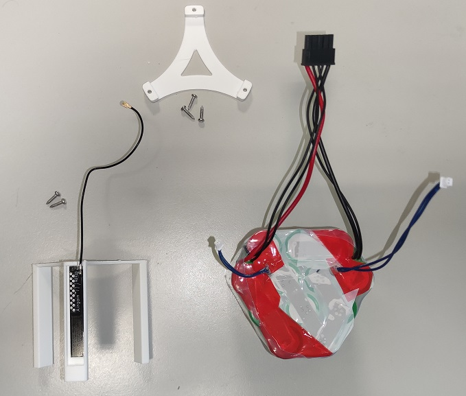</td>
    <td>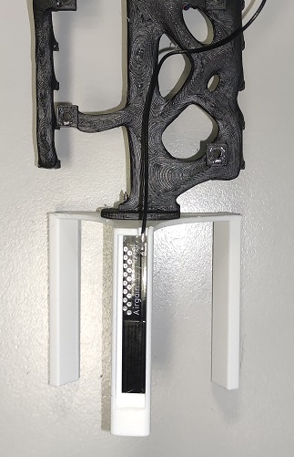</td>
    <td>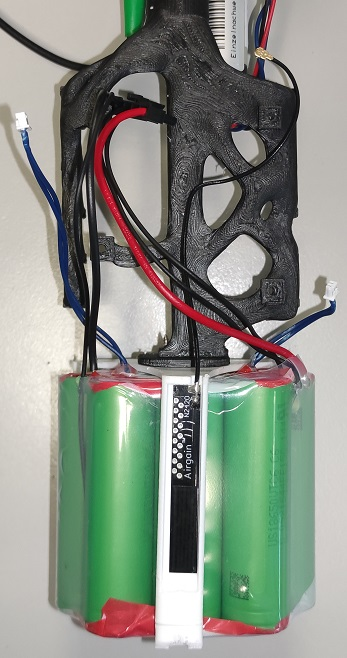</td>
    <td>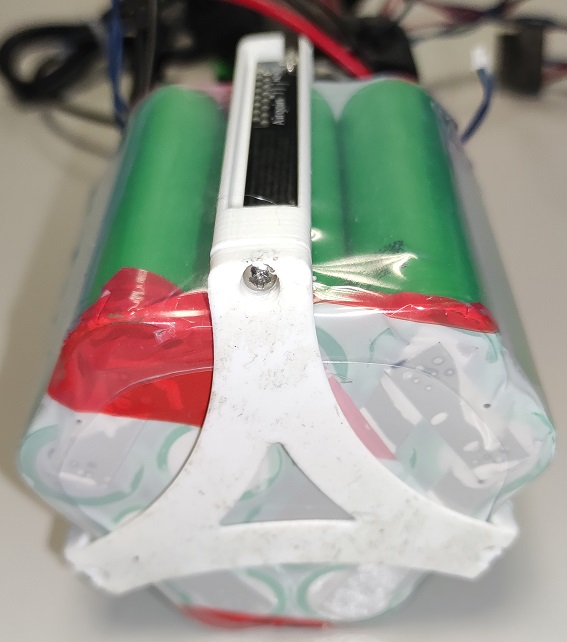</td>
  </tr>
</table>


## 2. Measurement Sensors

Attach the measurement sensors.

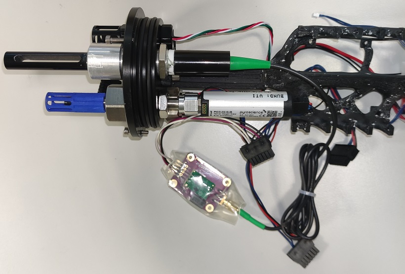

## 3. Mainboard and Interface Board

1. Connect the mainboard to the interface board.
2. Ensure the correct polarity of the connector.

<table>
  <tr>
    <td>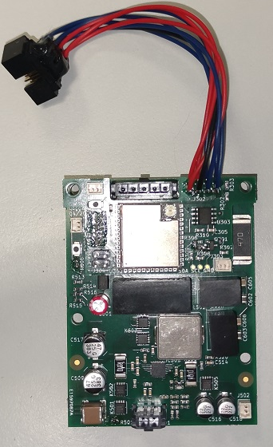</td>
    <td>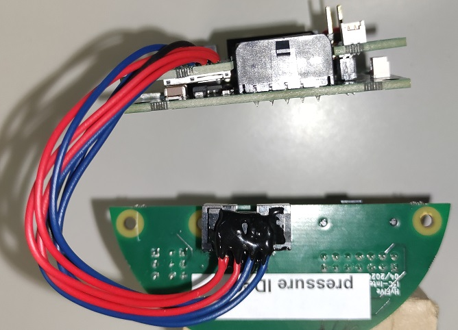</td>
    <td>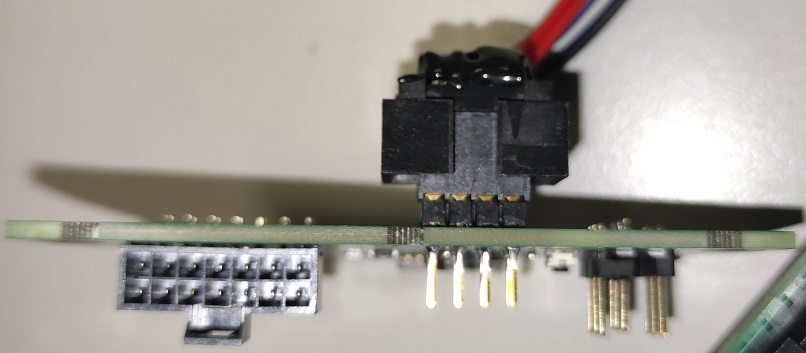</td>
  </tr>
</table>

## 4. Screw Components and Connect Plugs

1. Screw the parts together.
2. Plug in both NTC connectors.
3. Plug in the LED and reed switch connectors.
4. Connect the charging plug.
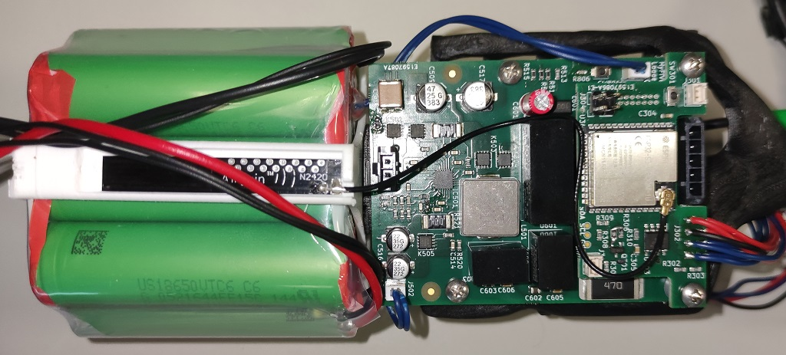

<table>
  <tr>
    <td>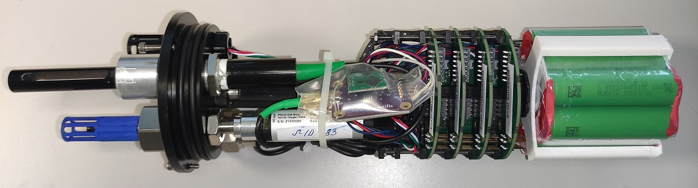</td>
    <td>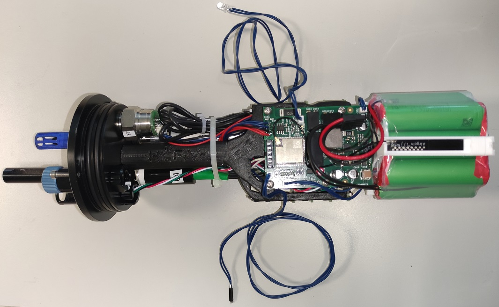</td>
    <td>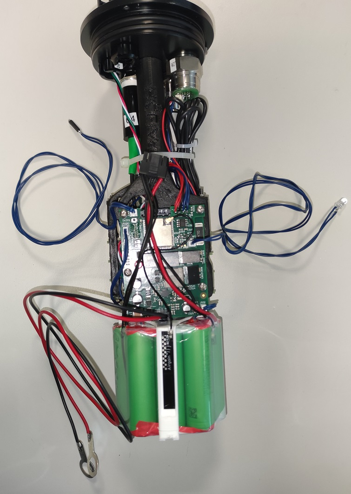</td>
  </tr>
</table>

## 5. LED and Reed Switch

1. Attach the LED and reed switch.
2. Secure them with hot glue.

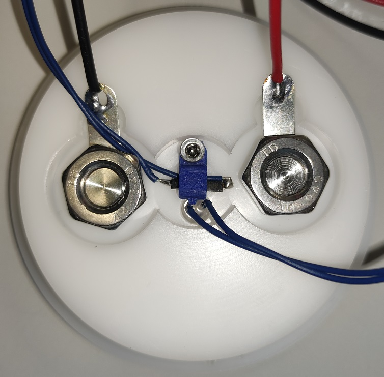

## 6. Configure SD Card

Configure the SD card with the file `loggerConfig/logger_XX_config_2024XXXXXXXX.json`. Pay attention to the following points:

1. **Filename**: 
   - Replace "XX" in the filename with the correct logger number and date in the format year/month/day/hour/minute.
   - Example: For logger 13, the filename would be `logger_13_config_202409131028.json`

2. **Logger ID**:
   - In the configuration file, the "logger_id" field must contain the correct logger number.
   - Example: `"logger_id": "13"`

3. **Wi-Fi Setup**:
   - Configure the Wi-Fi settings.
   - The first Wi-Fi login should be for the corresponding deck box.
   - You can configure up to 5 different Wi-Fi networks.

Example for Wi-Fi configuration:

```json
"wifi": [
  {
    "ssid": "Deckbox_SSID",
    "password": "Deckbox_Password"
  },
  {
    "ssid": "Second_WiFi",
    "password": "Second_Password"
  }
]
```


## 7. Connect Battery and Start Device

1. Connect the battery voltage to the mainboard.
2. Press the Boot-BMS button.
3. The board starts and can be assembled.
4. Leak test still needs to be carried out

<table>
  <tr>
    <td>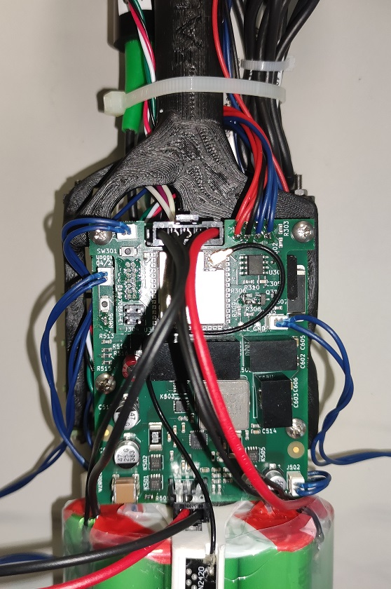</td>
    <td>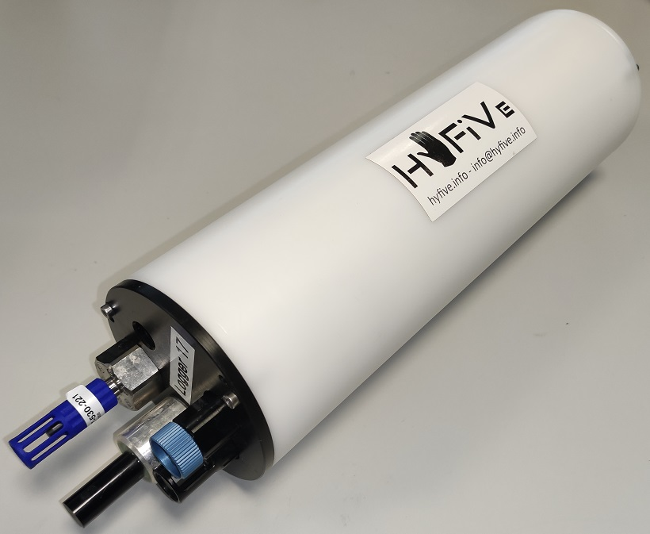</td>
    <td>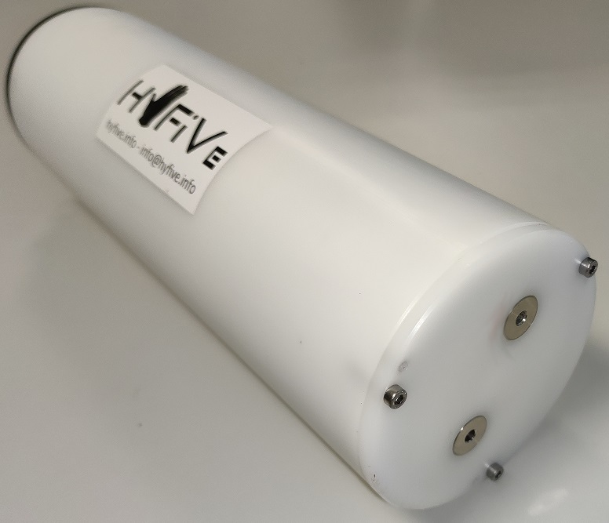</td>
  </tr>
</table>

## 8. Vacuum Leak Test

The following tools are required to perform the vacuum leak test:

Mityvac Hand Operated Vacuum Pump
https://bluerobotics.com/store/watertight-enclosures/enclosure-tools-supplies/vacuum-pump-kit-r2-rp/

Vacuum Plug
https://bluerobotics.com/store/watertight-enclosures/enclosure-tools-supplies/vacuum-plug/

Pressure Relief Valve Backfill Adapter
https://bluerobotics.com/store/watertight-enclosures/prv-m10-backfill-adapter/

After completing the assembly, a vacuum leak test must be performed to verify the watertight integrity of the enclosure.

1. Connect the vacuum pump to the enclosure using the appropriate adapter.
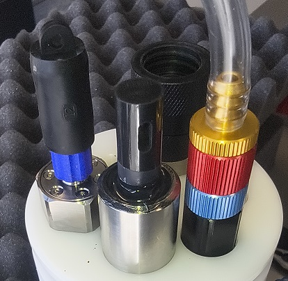

2. The target vacuum level is 30 inHg VAC (approx. 1 bar pressure differential).
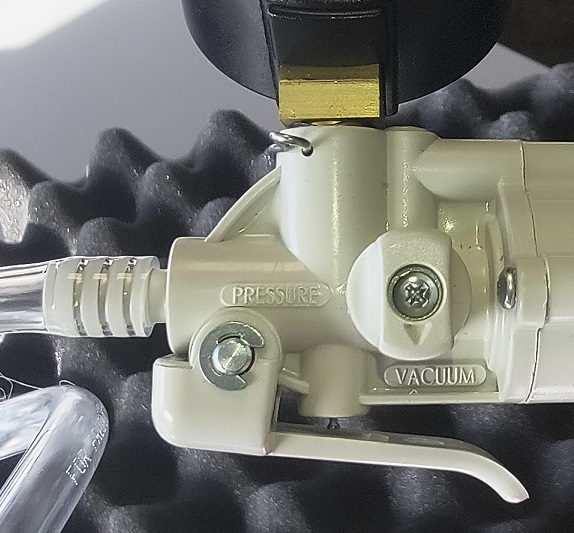

3. Monitor the achieved vacuum level for approximately 24 hours.

4. If the vacuum remains stable within the permissible tolerance, the leak test is considered successful.
